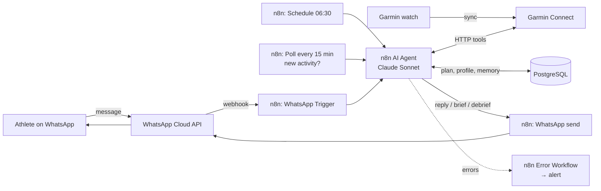

# Autonomous Agent Project Plan — "CoachLoop"

**An AI endurance coach on WhatsApp, fed by Garmin Connect data and orchestrated in n8n.**

> Submission scope: Part 1 (planning) only. Part 2 (prototype) was not built, so no workflow export or execution trace is attached.

---

## 1. Use Case

**Selected option:** E — Own idea

### Problem statement
Amateur endurance athletes (marathon, triathlon, cycling) wearing a Garmin watch collect detailed data every day: workouts, heart rate, HRV, sleep, stress, training load. Garmin shows the numbers but does not turn them into a day-by-day decision ("Should I do intervals today or go easy?", "Am I on track for a sub-3:45 in March?"). A human coach does this, but is expensive and not available on demand. Static training plans (PDFs, apps) do not adapt when the athlete sleeps badly, misses a session, or gets sick.

### Target users
- **Primary:** self-coached amateur endurance athletes training for a specific race (marathon, half, 70.3/Ironman), Garmin users, already living in WhatsApp.
- **Secondary (v3+):** independent human coaches who want an assistant that monitors their athletes between check-ins.
- **MVP user:** the founder (n=1), training for a marathon. See §3 and §4 for why the MVP is single-user.

### Current process (manual)
1. Athlete wakes up, opens Garmin Connect, checks sleep, HRV status and training readiness.
2. Opens a static plan (PDF, spreadsheet or a plan app) to see the scheduled session.
3. Decides alone whether to adjust it, or messages a human coach on WhatsApp and waits for an answer.
4. After the workout, checks the activity in Garmin Connect, sometimes copies numbers into a spreadsheet or into a ChatGPT chat to get feedback.
5. Every few weeks, re-evaluates race goal and pacing by hand.

### What the agent does instead
- **Morning brief (autonomous):** pulls last night's sleep/HRV and recent load, compares against the plan, and sends a WhatsApp message with today's session — adjusted if needed — plus the reason.
- **Post-workout debrief (autonomous):** detects a newly synced activity, compares it with what was planned, sends a short analysis and adjusts upcoming days if necessary.
- **On-demand Q&A (conversational):** the athlete asks anything about their training ("How was my week?", "What pace for Sunday's long run?", "I have a cold, what do I do?") and the agent answers using their real data.

### Why this needs an agent, not simple automation
- It must **decide which data to fetch** depending on the question (activities vs. sleep vs. HRV vs. plan).
- It must **reason across several sources** (plan + recent load + recovery signals + race date) and produce a recommendation.
- It must **act without being asked** (scheduled briefs, activity detection) and **update its own state** (the plan).

### Verification — how we know it's working
- Every number quoted in a WhatsApp reply can be traced back to a Garmin API response logged in the same n8n execution.
- The morning brief arrives every day by a set time, and the post-workout debrief arrives within a defined window after the watch syncs.
- The plan stored in the database changes when, and only when, the agent explains a reason for the change.
- The athlete (MVP user) rates replies weekly and follows the adjusted plan.

---

## 2. Technology Stack

### Technology Selection Framework

| Question | Answer | Consequence |
|---|---|---|
| Needs external knowledge? | **Partly.** Athlete data comes from tools, not documents. General training science comes from the LLM's own knowledge in the MVP. | **No RAG in MVP.** A small curated RAG of training principles is a v2 item. |
| Interacts with external systems? | **Yes** — Garmin Connect, WhatsApp, a database. | Tools / integrations required → **n8n**. |
| Multi-step reasoning? | **Yes, but bounded** — fetch data → compare with plan → recommend → optionally update plan. | **n8n AI Agent node with tools** is enough. LangGraph not needed for MVP. |
| Integrates with business systems? | **Yes** — messaging platform, data API, storage, schedulers. | **n8n** for orchestration. |
| Autonomous? | **Yes** — morning brief and activity detection run without user input. | Scheduling, error handling and monitoring required. |

### Selected stack

| Layer | Choice | Role |
|---|---|---|
| **Core LLM** | Anthropic Claude — Sonnet for the coaching agent, Haiku for cheap steps (intent routing, short summaries) | Reasoning, tool calling, writing the replies |
| **Agent framework** | n8n **AI Agent** node (tools agent) | Decides which tool to call and composes the answer |
| **Orchestration** | **n8n**, self-hosted in Docker on a small EU VPS (or n8n Cloud for speed) | Triggers, schedules, retries, logging |
| **Chat channel** | **WhatsApp Business Cloud API** via n8n's WhatsApp Trigger + WhatsApp Business Cloud nodes | Receive and send messages |
| **Fitness data** | **Garmin Connect Personal API** called with n8n HTTP Request nodes | Activities (JSON + .FIT), health data (sleep, HR, HRV, stress) |
| **State / memory** | PostgreSQL (athlete profile, race goal, training plan, activity log, chat memory) | Persistent plan and conversation context |
| **RAG (v2)** | pgvector in the same Postgres, a small corpus of self-written training notes | Grounded training-principle answers |

### Agent tools (each is an n8n sub-workflow or HTTP node)
1. `get_recent_activities(days)` — Garmin Personal API
2. `get_activity_detail(activity_id)` — Garmin Personal API
3. `get_daily_health(date)` — sleep, resting HR, HRV, stress — Garmin Personal API
4. `get_plan(from, to)` — Postgres
5. `update_plan_day(date, session, reason)` — Postgres (every change logged with a reason)
6. `get_athlete_profile()` — race, race date, goal time, zones, constraints — Postgres

### Architecture

Three entry points, one agent:
- **Inbound message** (WhatsApp Trigger) → agent answers.
- **Morning schedule** → agent builds the daily brief.
- **Activity poller** → compares the latest activity ID with the last one stored; if new, agent writes the debrief.

### Justification

- **n8n** — the course's orchestration tool; native WhatsApp trigger/send nodes, an AI Agent node with tool calling, scheduling, credentials store and an error-workflow mechanism, all without writing a backend. Visual executions double as the audit trail required for verification.
- **Garmin Personal API** — Garmin opened an official self-service Personal API in October 2026: the user creates a key in Garmin Connect web settings and exchanges it for an access token valid up to 24 hours. It covers activity data (JSON and .FIT) plus health data, is pull-only and read-only. It is the only official route available right now, because new applications to Garmin's business developer program are paused with no reopening date (Terra, Sept 2026).
- **WhatsApp** — where the target user already is; no app to install. A narrowly scoped training-coach bot is a specific function, not a general-purpose assistant (see risk T4).
- **Claude Sonnet + Haiku** — strong tool calling and reasoning on numeric data; tiering keeps cost down.
- **Postgres** — the training plan is structured, changing data; it must survive restarts and be queryable. n8n can use the same Postgres for chat memory.

### Alternatives considered

| Area | Alternative | Why not (for MVP) |
|---|---|---|
| Garmin data | Unofficial `python-garminconnect` / `garth` libraries | `garth` was deprecated in March 2026 after Garmin changed its auth flow; unofficial access is fragile and against the spirit of the Personal API terms. |
| Garmin data | Garmin Business tier (Health/Activity API, push webhooks) | New applications paused; also requires business approval. Target for v3. |
| Garmin data | Terra API (aggregator, already a Garmin partner) | Paid, adds a third party holding health data. Best route for the multi-user paid version (v2/v3). |
| Garmin data | Strava API | Activities only, no sleep/HRV; also stricter terms on AI processing since late 2024. |
| Chat | Telegram bot | Simpler (free, no Meta business verification, no AI policy question). Kept as **fallback channel**. |
| Agent framework | LangGraph / LangChain in Python | More control, but needs hosting and code; overkill for one agent with six tools. Reconsider if the reasoning grows into a multi-agent planner. |
| LLM | OpenAI GPT | Comparable; choice driven by preference. The n8n agent node makes swapping easy. |

### Trade-offs accepted
- **"Real-time" means near-real-time.** Garmin data only reaches the cloud after the watch syncs, and the Personal API is pull-only, so the bot polls. No live coaching during a workout.
- **Single user in MVP.** The Personal API is for the key-holder's own data, so it cannot serve paying customers. This is a deliberate MVP constraint, resolved in v2 via an aggregator or Garmin Business access.
- **No writing to the watch.** The Personal API is read-only; pushing structured workouts to the watch needs Garmin's Training API (Business tier). Workouts are sent as text in WhatsApp.

---

## 3. MVP Scope

### Feature brainstorm

| Feature | Category |
|---|---|
| Onboarding via chat: race, date, goal time, available days | **MVP** |
| Generate a base plan (weeks until race) and store it | **MVP** |
| Daily morning brief with today's session, adjusted by sleep/HRV/load | **MVP** |
| Post-workout debrief: planned vs. actual | **MVP** |
| On-demand Q&A on own data ("How was my week?") | **MVP** |
| Plan adjustment with logged reason | **MVP** |
| Safety guardrails (pain, illness, chest symptoms → stop and see a doctor) | **MVP** |
| Running only (marathon/half) | **MVP** |
| Triathlon (swim/bike/run) multi-sport planning | v2 |
| Multi-user with paid subscription (Terra or Garmin Business) | v2 |
| Weekly summary report | v2 |
| RAG on curated training principles | v2 |
| Voice notes (speech-to-text) | v2 |
| Nutrition and race-day fuelling plan | v2 |
| Push structured workouts to the watch (Training API) | v3 |
| Coach dashboard for human coaches managing several athletes | v3 |
| Other wearables (COROS, Apple Watch, Polar) | v3 |
| Multi-language (German, Italian) | v3 |

### MVP — included
- One athlete (founder), one sport (running), one race goal.
- WhatsApp text in and out, English only.
- Garmin Personal API: recent activities, activity detail, daily sleep/HR/HRV/stress.
- Three triggers: inbound message, morning schedule, 15-minute activity poller.
- Postgres: profile, plan, activity log, chat memory, plan-change log.
- Guardrails: no medical diagnosis; red-flag symptoms trigger a fixed "stop and consult a doctor" reply; agent only discusses training/recovery topics.
- n8n Error Workflow sending an alert on any failed execution.

### MVP — explicitly out of scope
- Other users, payments, sign-up flow.
- Triathlon, cycling, swimming plans.
- Live, in-workout coaching.
- Sending workouts to the watch.
- RAG, voice, images, nutrition plans.
- Any UI other than WhatsApp.

### Example end-to-end (critical path to prove first)
**Input:** athlete sends "How should I run today?" on WhatsApp.
**Agent:** calls `get_daily_health(today)`, `get_recent_activities(7)`, `get_plan(today)`.
**Output (WhatsApp):** "Planned: 8 × 400 m intervals. Your HRV is below your usual range and you slept under 6 h, after a big long run on Sunday. I've moved intervals to Thursday — today 40 min easy at conversational pace. Plan updated."
**Proof:** n8n execution shows the three tool calls with raw responses, and a new row in `plan_changes` with the reason.

---

## 4. Risk Assessment

### Technical risks

| # | Risk | Prob. | Impact | Mitigation |
|---|---|---|---|---|
| T1 | **Hallucinated numbers** — agent quotes a pace, HR or HRV value that isn't in the data | Medium | High | System prompt: only quote values returned by tools; agent must call a tool before stating any metric. Log raw tool output per execution; weekly spot-check of 10 replies against logs. |
| T2 | **Garmin Personal API changes or breaks** (new product, endpoints may change, no published rate limit) | Medium | High | All Garmin calls isolated in one sub-workflow; retry with backoff on 429/5xx; cache daily health data in Postgres so the agent doesn't re-fetch; alert on repeated failures. |
| T3 | **Token expiry** — access token valid max 24 h; API key has an expiry the user chooses | High | Medium | Token-refresh sub-workflow runs before every Garmin call when the token is older than ~20 h; alert one week before the API key expires. |
| T4 | **WhatsApp policy** — Meta banned general-purpose AI chatbots from the Business API from 15 Jan 2026 | Medium | High | Keep the bot strictly task-specific (training coaching only), refuse off-topic requests, frame it as a coaching service. Telegram as ready fallback channel. |
| T5 | **WhatsApp 24-hour window** — proactive messages (morning brief) outside the window need a pre-approved template and may be charged | High | Medium | Register a utility template for the daily brief; the athlete's reply reopens the window for free-form chat. Monitor message costs. |
| T6 | **Data delay** — watch not synced, so debrief or brief uses stale data | High | Medium | Agent checks the date of the latest data and says so explicitly ("No sync since yesterday — open Garmin Connect to sync"). |
| T7 | **Duplicate debriefs** — poller detects the same activity twice | Medium | Low | Store last processed activity ID; idempotency check before triggering the agent. |
| T8 | **Latency** — multi-tool agent replies take too long on WhatsApp | Medium | Medium | Haiku for routing, limit tool calls per turn, cache daily data; target p95 < 30 s. |

### Business risks

| # | Risk | Prob. | Impact | Mitigation |
|---|---|---|---|---|
| B1 | **No official path to multi-user Garmin data** — Personal API is own-data only; Business applications paused | High | High | MVP stays n=1 by design. v2 goes through Terra (already a Garmin partner) or Garmin Business once applications reopen. Price model must absorb aggregator cost. |
| B2 | **Willingness to pay** — free alternatives (Garmin Coach, ChatGPT with exported data) | Medium | High | Differentiate on proactivity (it messages you) and adaptivity (plan changes with reasons). Validate with 10 athlete interviews before building v2. |
| B3 | **Trust in AI coaching** — athletes ignore recommendations | Medium | Medium | Always explain the "why" with their own numbers; let the athlete override ("keep the intervals") and log it. |
| B4 | **Scope creep** — triathlon, nutrition, voice before running works | High | Medium | Hard MVP boundary (§3); new ideas go to a backlog file, not the build. |
| B5 | **Cost overruns** (LLM + WhatsApp + hosting) | Low | Medium | Model tiering, token caps per execution, monthly budget alert on the LLM provider account. |

### Data risks

| # | Risk | Prob. | Impact | Mitigation |
|---|---|---|---|---|
| D1 | **Health data privacy (GDPR)** — HR, HRV, sleep are health data (special category) | Medium | High | EU-hosted n8n and Postgres; minimum data sent to the LLM (summaries, not full .FIT files); no training on user data per provider terms; for v2, explicit consent, DPA with every processor, deletion on request. |
| D2 | **Secrets leakage** — Garmin key, WhatsApp token, LLM key | Low | High | n8n credentials store only; never in workflow JSON or the repo; strip before any export. |
| D3 | **Unsafe advice** — training through injury or illness | Low | High | Red-flag keyword/intent check before the agent runs; fixed referral reply; disclaimer in onboarding that this is not medical advice. |
| D4 | **Data quality** — wrist HR errors, missing sleep, GPS drift | Medium | Medium | Agent treats single outliers with caution and uses multi-day trends for decisions. |
| D5 | **Model bias toward generic plans** — advice tuned to "average" runners | Medium | Low | Personal zones and constraints stored in profile and always passed into context. |
| D6 | **Garmin attribution** — derived outputs must credit Garmin under its API brand guidelines | Low (MVP) | Medium (v2) | Add "Data: Garmin Connect" to briefs and reports from v2. |

### First failure mode to monitor if this runs daily
**Stale or missing Garmin data reaching the agent unnoticed** — an expired token or an unsynced watch silently produces a morning brief based on old data. Monitor: timestamp of the latest health record and latest activity at every brief; alert if older than 24 h or if the token exchange fails.

---

## 5. Implementation Plan

### Phases

**Phase 1 — Setup and data preparation (≈ 4 days)**
- Create Garmin Personal API key; test token exchange and the activity and health endpoints with n8n HTTP Request nodes; save sample responses.
- Create Meta developer app, WhatsApp Business Cloud test number, connect n8n WhatsApp Trigger (incl. subscribing the app to the WhatsApp Business Account).
- Deploy n8n + Postgres (Docker, EU VPS); create tables: `athlete_profile`, `plan`, `plan_changes`, `activities_seen`, `chat_memory`.
- Write the athlete profile and a first 12–16-week marathon plan into the database.
- **Milestone M1:** a WhatsApp "ping" returns the date and distance of the latest Garmin activity.

**Phase 2 — Core agent development (≈ 5 days)**
- Build the six tools as sub-workflows.
- Configure the AI Agent node: system prompt (role, data-only rule, guardrails, tone), tools, Postgres chat memory keyed by phone number.
- Build the token-refresh and red-flag pre-check sub-workflows.
- Test 20 scripted questions against real data.
- **Milestone M2:** agent answers on-demand questions correctly, every metric traceable to a tool call.

**Phase 3 — Integration and testing (≈ 4 days)**
- Morning-brief schedule + WhatsApp utility template.
- Activity poller with duplicate detection → debrief.
- Plan-update flow with logged reasons.
- n8n Error Workflow → alert message.
- Edge cases: no sync, rest day, missed workout, illness message, off-topic request.
- **Milestone M3:** one full week where all three entry points run without manual intervention.

**Phase 4 — Deployment and monitoring (≈ 3 days + 2-week run)**
- Move to permanent hosting, set backups for Postgres, set LLM budget alerts.
- Daily check of executions; weekly hallucination spot-check; weekly self-rating.
- Two-week live run, then a retro and a go/no-go decision for v2 (multi-user via Terra).
- **Milestone M4:** two-week live run completed, metrics in §6 measured.

### Timeline (part-time, alongside the bootcamp)

| Phase | Duration | Ends with |
|---|---|---|
| 1. Setup & data | Week 1 | M1 |
| 2. Core agent | Week 2 | M2 |
| 3. Integration & testing | Week 3 | M3 |
| 4. Deployment & monitoring | Week 4 + 2-week live run | M4 |

### Dependencies
- Garmin Personal API remains available and covers sleep/HRV endpoints (verify in Phase 1; if HRV is missing, fall back to resting HR + sleep).
- Meta developer account and WhatsApp test number (Business verification needed only for production numbers).
- Phase 2 depends on M1; Phase 3 depends on M2; templates must be approved by Meta before the morning brief can run outside the 24-hour window.

### Resources needed

**Team (MVP):** one person covering all roles — product owner, n8n builder, prompt engineer, test user. Optional reviewer: a running coach to sanity-check the plan logic (1–2 hours).

**Tools and services**
- n8n (self-hosted, free Community edition, or n8n Cloud)
- EU VPS for n8n + Postgres
- Anthropic API key
- Meta developer account + WhatsApp Business Cloud API
- Garmin Connect account + Personal API key (free)
- GitHub repo for the plan, prompts and sanitised workflow exports

**Budget considerations (estimates, single user — to verify before build)**
- Hosting: small EU VPS, low single-digit € per month (n8n Cloud costs more).
- LLM: tens of short agent runs per day → expected low single-digit to low double-digit € per month with Sonnet/Haiku tiering; capped with a budget alert.
- WhatsApp: replies inside the 24-hour window fall within Meta's free monthly service allowance at this volume; the daily brief template outside the window is charged per message at the utility rate for Germany.
- Garmin Personal API: free.
- v2 cost driver to model before pricing: per-user fee of a data aggregator (Terra) + per-user LLM and WhatsApp costs.

---

## 6. Success Metrics

### Technical (MVP, measured over the 2-week live run)
| Metric | Target |
|---|---|
| Morning brief delivered on time | ≥ 13 of 14 days |
| Debrief sent after a synced activity | ≥ 95% of activities, within 30 min of sync |
| Reply latency (inbound message → answer) | p95 < 30 s |
| Numbers in replies traceable to a tool response | 100% of spot-checked replies |
| Failed executions without an alert | 0 |
| Duplicate debriefs | 0 |

### Product (MVP user)
| Metric | Target |
|---|---|
| Planned sessions completed as recommended (or adjusted by the agent) | ≥ 80% |
| Self-rated usefulness of replies (1–5, weekly) | ≥ 4 |
| Days the athlete still had to open Garmin Connect to decide the session | Trending to 0 |
| Plan changes with a clear, data-backed reason | 100% |

### Business (gate for v2)
| Metric | Target |
|---|---|
| Athlete interviews completed | 10 |
| Interviewees who would pay a monthly subscription | ≥ 4 of 10 |
| Estimated cost per user per month (data + LLM + WhatsApp) | Well below the intended price point |

### Verify
A reviewer can open one n8n execution of the morning brief and see: the trigger, the Garmin tool calls with raw responses, the plan lookup, the agent output, and the WhatsApp message ID — and confirm the message on the phone matches the execution output.

---

## Sources
- [Garmin Connect Developer Program — overview (Personal / Starter / Enterprise tiers)](https://developer.garmin.com/gc-developer-program/overview)
- [Garmin Connect Personal API — FAQ](https://developer.garmin.com/gc-developer-program/personal/personal-faq/)
- [Terra — Garmin's Connect Developer Program is paused (Sept 2026)](https://tryterra.co/blog/garmin-connect-developer-program-pause)
- [matin/garth — deprecation notice](https://github.com/matin/garth)
- [TechCrunch — WhatsApp bars general-purpose chatbots (effective 15 Jan 2026)](https://techcrunch.com/2025/10/18/whatssapp-changes-its-terms-to-bar-general-purpose-chatbots-from-its-platform)
- [n8n docs — WhatsApp Trigger node](https://docs.n8n.io/integrations/builtin/trigger-nodes/n8n-nodes-base.whatsappTrigger/)
- [Meta — Pricing on the WhatsApp Business Platform](https://developers.facebook.com/docs/whatsapp/pricing)
